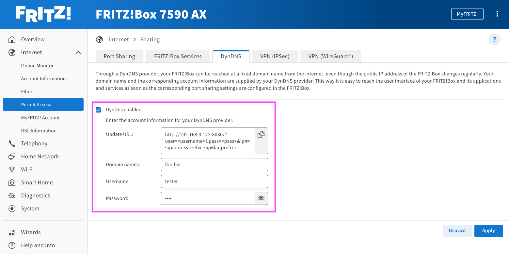

# Configuration

The tool is designed to run in a Docker container. It uses less than 10 MB memory and does not have high CPU peaks. Anyways, you can also build a Go updater running outside a container.

To configure the updater, copy [env.example](./env.example) to `.env` (used by [compose.yaml](./compose.yaml)) and customize it and [config.yaml](./config.yaml) according to your needs. Following configuration options are available.

## DNS

Following structure is required for DNS records:

```yaml
dns-zones:
  - zone-name: example.com   # DNS zone name
    records:
      - type: A              # Record type A or AAAA
        name: test           # Name -> test.example.com
        ttl: 300             # TTL (3600 if not set)
        comment: Comment     # A custom comment (optional)
```

You can use multiple records in multiple different DNS zones.

## Firewall

This structure is required for Firewalls:

```yaml
firewalls:
  - id: 123456789            # hcloud Firewall id
    fw-rules:
      - description: ssh     # Description (optional but recommended)
        direction: in        # Direction in or out
        port: 22             # Port
        protocol: tcp        # Protocol
        ipv4mask: 32         # CIDR for IPv4 address (32 if not set)
        ipv6mask: 64         # CIDR for IPv6 address (128 if not set)
```

You can manage multiple rules on multiple different Firewalls. Also see following topics:

- How to retrieve the Firewall id? -> see below
- [Introduction to CIDR](https://blog.ip2location.com/knowledge-base/a-comprehensive-guide-to-ipv4-and-ipv6-cidr/)

## Docker compose settings

```yaml
services:
  updater:
    image: hcloud-ddns-fw:latest
    network_mode: host
    mem_limit: 32M
    environment:
      HCLOUD_TOKEN: yourSecretHcloudToken
      UPDATE_INTERVAL: 300
      HTTP_TIMEOUT: 30
      IP_MODE: IPv4
      LOGLEVEL: INFO
      TZ: Europe/Berlin
    volumes:
      - ./config.yaml:/app/config.yaml
    restart: always
```

Further examples can be found [in this](./examples/) directory.

### `HCLOUD_TOKEN:`

hcloud API token. ‼️ **This token is mighty. Handle with care.** ‼️

```bash
HCLOUD_TOKEN: yourSecretHcloudToken
# type: string
```

### `TRIGGER`

Trigger that controls the update process. Available options are (case-insensitive):

- `interval` (default) look for IP changes after seconds configured in `UPDATE_INTERVAL`
- `updateUrl` start an HTTP server and run the update whenever a DDNS update URL is called, see [DDNS update URL](#ddns-update-url)

```bash
TRIGGER: interval
# type: string
```

### `UPDATE_INTERVAL`

Interval in seconds to check for IP address changes. Required and used only when `TRIGGER` is `interval`.

```bash
UPDATE_INTERVAL: 300
# type: int
```

### `IP_ADDRESS_SRC`

Source where to get the IP addresses from. Available options are (case-insensitive):

- `apiUrl` (default) use default or provided IP API endpoint(s), see `IPv4_API_URL` and `IPv6_API_URL`
- `updateUrl` take the IP addresses from the parameters of the DDNS update URL. Requires `TRIGGER: updateUrl`

```bash
IP_ADDRESS_SRC: apiUrl
# type: string
```

### `UPDATE_URL_USER` and `UPDATE_URL_PASS`

Credentials that must be sent as `user` and `pass` parameters of the DDNS update URL. Required when `TRIGGER` is `updateUrl`.

```bash
UPDATE_URL_USER: ddns
UPDATE_URL_PASS: yourSecretPassword
# type: string
```

### `UPDATE_URL_LISTEN`

Address the DDNS update URL server listens on, as `<ip>:<port>` or `:<port>`. Used only when `TRIGGER` is `updateUrl`. Defaults to `:8080` (all interfaces).

With `network_mode: host`, `:8080` listens on **every** interface of the host, possibly including public ones. Bind it to your LAN address instead, e.g. `192.168.0.123:8080`.

```bash
UPDATE_URL_LISTEN: 192.168.0.123:8080
# type: string
```

### `IPv6_INTERFACE_ID`

Interface ID of the NIC. Basically the second half of an IPv6 address such as 2a24:b19c:d942:b8bc:**66ec:face:7324:81ea**

Used only with `IP_ADDRESS_SRC: updateUrl`, where the host's IPv6 address is built from the `prefix` parameter of the update URL, the prefix length, `IPv6_PREFIX_ID` (optional) and this interface ID. Required if `IP_MODE` is `IPv6` or `Dual`.

```bash
IPv6_INTERFACE_ID: 66ec:face:7324:81ea
# type: string
```

### `IPv6_PREFIX_ID`

Prefix ID (subnet ID, hex) placed between the prefix length and /64, if your network uses one. With prefix `2a24:b19c:d942:b800::/56` and prefix ID `bc` the resulting network is `2a24:b19c:d942:b8bc::/64`.

```bash
IPv6_PREFIX_ID: bc
# type: string
```

### `IPv6_PREFIX_LENGTH`

IPv6 prefix length (1-64). Used only with `IP_ADDRESS_SRC: updateUrl`. If set, it overrides the length sent in the `prefix` parameter (e.g. to apply `IPv6_PREFIX_ID` to a /64 LAN prefix sent by the router). If not set, the length from the `prefix` parameter is used.

```bash
IPv6_PREFIX_LENGTH: 56
# type: int
```

### `HTTP_TIMEOUT`

Timeout for http requests, used for fetching your public IP address and to run updates on hcloud DNS records or Firewalls. Don't set this to low, since the updater will also check for success within the same ongoing period.

```bash
HTTP_TIMEOUT: 30
# type: int
```

### `IP_MODE`

Select IP mode to be used. Available options are:

- `IPv4` only use IPv4
- `IPv6` only use IPv6
- `Dual` use both IPv4 and IPv6

```bash
IP_MODE: IPv4
# type: string
```

### `LOGLEVEL`

Log level of the updater. Available options are:

- `ERROR`
- `INFO` default setting
- `DEBUG`

```bash
LOGLEVEL: INFO
# type: string
```

### `TZ`

Time zone setting. Also see [https://utctime.info/timezone/](https://utctime.info/timezone/).

```bash
TZ: Europe/Berlin
# type: string
```

### `IPv4_API_URL` \*optional

Add a different or own API endpoint to fetch the IPv4 address from. Leave blank or don`t set to use https://api.ipify.org

```bash
IPv4_API_URL: https://api.example/ipv4
# type: string
```

**Important:** Responses must be plain text like `123.123.123.123`

### `IPv6_API_URL` \*optional

Add a different or own API endpoint to fetch the IPv6 address from. Leave blank or don`t set to use https://api6.ipify.org

```bash
IPv6_API_URL: https://api.example/ipv6
# type: string
```

**Important:** Responses must be plain text like `1234:5678:90ab:cdef:1234:5678:90ab:cdef`

## DDNS update URL

With `TRIGGER: updateUrl` the updater does not poll. Instead it listens on `UPDATE_URL_LISTEN` and runs an update whenever a router or script calls a URL like this:

```
http://<host>:8080/?user=<username>&pass=<pass>&ip4=<ipaddr>&prefix=<ip6lanprefix>
```

| Parameter      | Meaning                                                                                                                                                                |
| -------------- | ---------------------------------------------------------------------------------------------------------------------------------------------------------------------- |
| `user`, `pass` | Must match `UPDATE_URL_USER` and `UPDATE_URL_PASS`                                                                                                                     |
| `ip4`          | IPv4 address (used with `IP_ADDRESS_SRC: updateUrl`)                                                                                                                   |
| `prefix`       | IPv6 prefix (used with `IP_ADDRESS_SRC: updateUrl`). The host's IPv6 address is built from this prefix, `IPv6_PREFIX_LENGTH`, `IPv6_PREFIX_ID` and `IPv6_INTERFACE_ID` |

The placeholders `<username>`, `<pass>`, `<ipaddr>` and `<ip6lanprefix>` are the ones used by your Router for a custom DynDNS provider. Routers may use different placeholders, the parameter names `user`, `pass`, `ip4` and `prefix` stay the same. Additional parameters are ignored.

You can find a config example of a FRITZ!Box 7590 below.



With `IP_ADDRESS_SRC: updateUrl`, the IP addresses are only transmitted when the router calls the update URL, which usually happens after its IP address has changed or after a period of time. Until then the updater may not know any IP address, e.g. right after the very first start, so no update takes place. Bind mount `/app/state` to keep the last known addresses across container recreation (see the example below): on every start the updater then immediately runs an update with them, so changes to `config.yaml` take effect after `docker compose up -d` without waiting for the router.

```yaml
volumes:
  - ./config.yaml:/app/config.yaml
  - ./state:/app/state
```

‼️ The password is sent as a URL parameter in plain HTTP. Only expose it in your local network, e.g. by binding `UPDATE_URL_LISTEN` to your LAN address. ‼️

An example can be found in [compose.updateUrl.yaml](./examples/compose.updateUrl.yaml).
